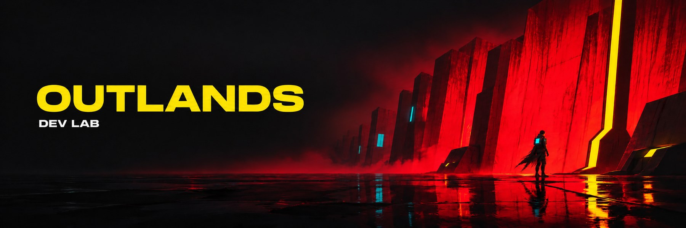

  <a href="#codex-research">Codex research</a> ·
  <a href="#outlands-projects">OUTLANDS projects</a> ·
  <a href="#game-projects">Game projects</a> ·
  <a href="#applications-and-tools">Applications and tools</a> ·
  <a href="#about-and-links">About</a>

# Connor O'Shea · OUTLANDS Dev Lab

I build local software for reporting, source review, and operating systems people can maintain themselves. I also publish independent Codex research, self-hosting reference systems, and game development projects.

## Codex research

I investigate Codex reliability through source review and isolated tests. I aim to give maintainers and other developers a clear account of what I observed, what I checked, and where the evidence stops.

| Selected work | What I investigated | Public evidence |
| --- | --- | --- |
| **Plugin refresh latency** | Measured Git-backed plugin refresh delays and compared a local Linux candidate with upstream behavior. | [Issue #58885](https://github.com/openai/codex/issues/58885) |
| **File search accuracy** | Checked how overlapping roots affected duplicate search results and whether valid matches were kept. | [Issue #60591](https://github.com/openai/codex/issues/60591) |
| **Thread search** | Investigated a Unicode substring search miss and tested a local candidate correction. | [Issue #60589](https://github.com/openai/codex/issues/60589) |
| **Terminal math rendering** | Checked underbrace annotations in a local renderer and proposed a bounded terminal layout. | [Issue #61792](https://github.com/openai/codex/issues/61792#issuecomment-6936878768) |

[Read the full Codex research record and dated maintainer notes](docs/CODEX-RESEARCH.md).

## OUTLANDS projects

These projects cover self-hosting, local AI development, mobile development, and protocol engineering. Each project links to its setup or research evidence.

| Project | What it does | Start here |
| --- | --- | --- |
| **Private Workspace Blueprint** | Shows how to assemble a private app hub with Homepage, Docker, and Tailscale. Runnable examples cover owner and reader roles, state, recovery, and OIDC with a fake provider. | [Build guide](https://github.com/TheOutlandsDev/outlands-private-workspace-blueprint) |
| **Agent Workbench** | Provides a browser workspace for running an opted-in local coding workflow against a project copy, inspecting the diff, and downloading a patch for review. | [Invented demo and setup](https://github.com/TheOutlandsDev/outlands-agent-workbench) |
| **Dev Phone** | Documents an Android development console that runs small programs locally and connects to an existing development PC. Includes acceptance evidence from one evaluated phone. | [Source and method](https://github.com/TheOutlandsDev/outlands-dev-phone) |
| **OUTLANDS Protocol** | An original Rust reference implementation for studying account transitions, consensus, storage, and peer sessions. Published as research source. | [Component map and checks](https://github.com/TheOutlandsDev/outlands-protocol) |

## Game projects

I build game systems, modding tools, and server recovery workflows. The project guides explain the required game versions, third-party dependencies, and which workflows have been tested.

### Mods and player setups

| Project | What it does | Start here |
| --- | --- | --- |
| **OUTLANDS SPT** | Provides matching Client and SelfHost setup, update helpers, and headless diagnostics for a compatible SPT installation. | [Compatibility and setup](https://github.com/TheOutlandsDev/outlands-spt-modpack) |
| **OUTLANDS BO2** | Adds private multiplayer setup, native bots, and progression features, with platform-specific validation. | [Project guide](https://github.com/TheOutlandsDev/outlands-bo2-mod) |
| **GAMMA Clear Sky Warfare** | Adds campaign presets and optional addons, with a separate experimental co-op launcher and Story workshop. | [Choose a test track](https://github.com/TheOutlandsDev/gamma-clearsky-warfare) |
| **IW4x Bot Warfare Extras** | Adds bot behaviors and presets along with a local learning-file trainer. | [Setup and commands](https://github.com/TheOutlandsDev/iw4x-bot-warfare-extras) |
| **State of Decay 2 QOL** | Collects experimental setup recipes for first-person play, storage, recruitment, and other quality-of-life changes. | [Setup and compatibility](https://github.com/TheOutlandsDev/outlands-state-of-decay-2-qol) |

### Game operations and reusable tools

| Project | What it does | Start here |
| --- | --- | --- |
| **OUTLANDS Game Tools** | Collects diagnostics, save utilities, and original SPT modules. The fictional LTX example can be run without a game installed. | [Choose a tool](https://github.com/TheOutlandsDev/outlands-game-tools) |
| **OUTLANDS WoW** | Preserves gameplay modules, database changes, and an operations kit for rebuilding the Living Azeroth server. Includes isolated reconstruction and recovery evidence. | [Source kit and rebuild path](https://github.com/TheOutlandsDev/outlands-wow) |
| **Over The Top: WWI Server Manager** | Provides dedicated-server lifecycle controls, campaign checkpoints, health checks, and recovery and rollback tools. | [Manager source and guide](https://github.com/TheOutlandsDev/outlands-ott-wwi-server-manager) |

## Applications and tools

### Try an application

| Project | What it does | Try it |
| --- | --- | --- |
| **Workfloor** | Reviews overdue work orders, shows the source records behind a report, and checks for inflated SQL counts. The demo uses invented manufacturing records. | [Browser demo](https://connor-oshea-outlands.thatrobotguy.chatgpt.site/demos/workfloor/) · [Source and setup](https://github.com/TheOutlandsDev/workfloor) |
| **Code Atlas** | Maps selected project folders and opens source in read-only VS Code tabs. The project includes native Linux validation. | [Browser demo](https://connor-oshea-outlands.thatrobotguy.chatgpt.site/demos/code-atlas/) · [Source and setup](https://github.com/TheOutlandsDev/code-atlas) |
| **Local Site Builder** | Builds a small website locally with a browser editor, separate draft and published content, and verified backup and restore. | [Maintained application](https://github.com/TheOutlandsDev/outlands-public-tools/tree/main/tools/local-site-builder) · [Standalone source and history](https://github.com/TheOutlandsDev/outlands-local-site-builder) |
| **Portfolio Builder** | Turns structured project records into a portfolio PDF, offline HTML index, and evidence package. | [Maintained application](https://github.com/TheOutlandsDev/outlands-public-tools/tree/main/tools/portfolio-builder) · [Standalone source and history](https://github.com/TheOutlandsDev/outlands-portfolio-builder) |

### Find a tool or worked example

| I want to… | Where to start |
| --- | --- |
| Browse reusable Python tools and complete local applications | [OUTLANDS Public Tools](https://github.com/TheOutlandsDev/outlands-public-tools) · [Complete tool catalog](https://github.com/TheOutlandsDev/outlands-public-tools/blob/main/catalog/generated/INDEX.md) |
| Validate source, compare revisions, or run a reporting exercise | [Developer Workspace and SQL Report Workbench guide](https://github.com/TheOutlandsDev/outlands-public-tools/blob/main/docs/START-HERE.md) |
| See a local dashboard with invented CPU, memory, and network data | [Resource Monitor browser demo](https://connor-oshea-outlands.thatrobotguy.chatgpt.site/demos/resource-monitor/) |
| Prepare a bounded source export with file selection and hash evidence | [Source Export Gate](https://github.com/TheOutlandsDev/source-export-gate) |
| Follow short, reproducible examples across categories | [Public tool workshops](https://github.com/TheOutlandsDev/outlands-public-tools/tree/main/workshops) · [Worked methods](https://github.com/TheOutlandsDev/outlands-public-tools/tree/main/methodology/worked-examples) |

[See the application download references, platform checks, and case notes](docs/APPLICATION-NOTES.md).

## About and links

I'm Connor O'Shea, a **software developer and U.S. Army veteran with hands-on medical-device manufacturing experience**. My manufacturing background keeps me focused on clear workflows, reliable records, and making tools usable by the next person.

  <a href="https://connor-oshea-outlands.thatrobotguy.chatgpt.site">Portfolio</a> ·
  <a href="https://www.linkedin.com/in/connor-o-shea-281173254/">LinkedIn</a> ·
  <a href="https://bugcrowd.com/h/therobotguy">Bugcrowd</a> ·
  <a href="https://www.youtube.com/@TheOutlandsDev">YouTube</a> ·
  <a href="https://www.linkedin.com/in/connor-o-shea-281173254/details/featured/">Case studies</a> ·
  <a href="https://github.com/TheOutlandsDev/TheOutlandsDev/blob/main/assets/SHOWCASE.md">Interface demos</a>

[Browse the project map](https://github.com/TheOutlandsDev/outlands-public-tools/blob/main/docs/PROJECT-MAP.md) for relationships between repositories. For a setup question, bug, or idea, open an issue in the relevant project with the version and a small example.

Original work is developed with AI assistance. Each repository documents its own license, upstream credits and validation scope.
