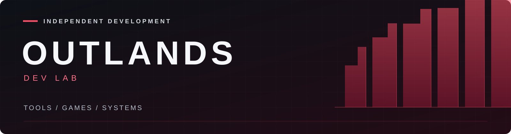

  <a href="#start-here">Start here</a> ·
  <a href="#games--modding">Games &amp; modding</a> ·
  <a href="#infrastructure--research">Infrastructure &amp; research</a> ·
  <a href="https://github.com/TheOutlandsDev/outlands-public-tools/blob/main/docs/PROJECT-MAP.md">Project map</a>

  <a href="https://connor-oshea-outlands.thatrobotguy.chatgpt.site">Portfolio</a> ·
  <a href="https://www.linkedin.com/in/connor-o-shea-281173254/">LinkedIn</a> ·
  <a href="https://www.youtube.com/@TheOutlandsDev">YouTube</a> ·
  <a href="https://www.linkedin.com/in/connor-o-shea-281173254/details/featured/">Case studies</a> ·
  <a href="assets/SHOWCASE.md">Interface demos</a>

# Connor O'Shea

I'm Connor O'Shea, a **full-stack developer and U.S. Army veteran with hands-on medical-device manufacturing experience**. I'm transitioning into a dedicated software development role.

I build practical applications for reporting, planning, diagnostics and reliable data workflows across Windows and Linux. My manufacturing background keeps me focused on clear workflows, accurate results, preserving records and making tools usable by the next person.

**OUTLANDS Dev Lab** is the public home for my personal applications, developer utilities and integration projects.

## Start here

| Application | Problem and design | Try it or inspect the evidence |
| --- | --- | --- |
| **[Workfloor](https://github.com/TheOutlandsDev/workfloor)** | Original synthetic manufacturing and SQL workbench: CSV preview, transactional imports, delayed reports and preserved SQLite snapshots. | [Download v0.2.0](https://github.com/TheOutlandsDev/workfloor/releases/tag/v0.2.0) · [Case study](https://connor-oshea-outlands.thatrobotguy.chatgpt.site/#workfloor) |
| **[Local Site Builder](https://github.com/TheOutlandsDev/outlands-public-tools/tree/main/tools/local-site-builder)** | Maintain a small website locally. SQLite stores separate drafts and published content; backups are verified before restoring into a new directory. | [Quick start and fictional workflow](https://github.com/TheOutlandsDev/outlands-public-tools/tree/main/tools/local-site-builder#start-here) · [Recorded Windows validation and limits](https://github.com/TheOutlandsDev/outlands-public-tools/blob/main/tools/local-site-builder/docs/VALIDATION.md) |
| **[Code Atlas](https://github.com/TheOutlandsDev/code-atlas)** | Navigate selected project folders with a visual map and read-only source browsing. Python scanning and a JavaScript VS Code extension keep projects in their existing locations. | [Fictional browser demo](https://connor-oshea-outlands.thatrobotguy.chatgpt.site/demos/code-atlas/) · [Linux preview setup](https://github.com/TheOutlandsDev/code-atlas/blob/main/docs/setup-r2.md) |

Also explore the [Resource Monitor fictional browser demo](https://connor-oshea-outlands.thatrobotguy.chatgpt.site/demos/resource-monitor/) and the full [Public Tools collection](https://github.com/TheOutlandsDev/outlands-public-tools).

### Local Site Builder: my contribution

I designed the application: its requirements, interface and workflows, SQLite storage, draft/publish behavior, and backup/restore approach. I also handled integration and debugging, with AI assistance during implementation.

One consequential decision was keeping draft and published content separate so an unfinished edit stays private. Recovery restores verified backup contents into a fresh directory and refuses an existing destination. The tradeoff is that database changes and generated HTML are not one atomic transaction; a disk failure can leave publication incomplete and require a retry. The [validation notes](https://github.com/TheOutlandsDev/outlands-public-tools/blob/main/tools/local-site-builder/docs/VALIDATION.md) record the Windows checks and remaining limits.

### Reading the evidence

These are personal projects with public source. [Workfloor](https://github.com/TheOutlandsDev/workfloor/blob/main/docs/VALIDATION.md) uses invented manufacturing data; v0.2 passed 39 tests plus fresh-database CLI and Windows launcher checks. Its observed browser workflow blocked an invalid CSV, imported three orders, and reopened the earlier nine-order snapshot after restart. Linux/macOS execution remains unqualified. Local Site Builder's Windows tests and draft-to-publish walkthrough are previously recorded in its documentation. Resource Monitor has a checked Windows fictional-demo first run. Code Atlas's public browser demo demonstrates its interface; the fresh Linux/VS Code acceptance test in this portfolio review remains pending. Browser demos do not establish live sampling, source scanning or native extension behavior.

The [Public Tools collection](https://github.com/TheOutlandsDev/outlands-public-tools) contains the application catalog. [Raid Control](https://connor-oshea-outlands.thatrobotguy.chatgpt.site/#raid-control) is a separate private-host dashboard case study with a sanitized idle-state capture and explicit validation limits.

## Games & modding

| Project | Focus | Current boundary |
| --- | --- | --- |
| **[Outlands SPT](https://github.com/TheOutlandsDev/outlands-spt-modpack)** | Matching Client/SelfHost setup, updater and headless diagnostics. | Read the current release; fresh Windows and shared two-player acceptance remain pending. |
| **[Outlands BO2](https://github.com/TheOutlandsDev/outlands-bo2-mod)** | Private multiplayer, native bots, earned progression and optional local Ollama chat. | Platform-specific validation is documented; Windows progression after relaunch remains pending. |
| **[GAMMA Clear Sky Warfare](https://github.com/TheOutlandsDev/gamma-clearsky-warfare)** | Campaign presets, original addons and an experimental host/join launcher. | Private solo baseline checked; independent installation and two-PC co-op remain unverified. |
| **[IW4x Bot Warfare Extras](https://github.com/TheOutlandsDev/iw4x-bot-warfare-extras)** | Original extensions, presets, learning tools and a command guide. | Offline source checks; live gameplay remains unverified. |
| **[State of Decay 2 QOL](https://github.com/TheOutlandsDev/outlands-state-of-decay-2-qol)** | First-person, storage, recruitment and influence setup recipes. | Experimental source tools; obtain dependencies from their authors. |

## Infrastructure & research

- **[Private Workspace Blueprint](https://github.com/TheOutlandsDev/outlands-private-workspace-blueprint)** — a guided Homepage, Docker and Tailscale workspace with original theme examples and access-check walkthroughs.
- **[OUTLANDS Protocol](https://github.com/TheOutlandsDev/outlands-protocol)** — Rust protocol research covering canonical encoding, state transitions, consensus and bounded P2P. Research source; no deployed network or production wallet is claimed.

## How the projects connect

**Public Tools** is the maintained home for the [Local Site Builder](https://github.com/TheOutlandsDev/outlands-public-tools/tree/main/tools/local-site-builder) and [Portfolio Builder](https://github.com/TheOutlandsDev/outlands-public-tools/tree/main/tools/portfolio-builder). Their earlier standalone repositories remain available as history. **Game Tools** collects reusable utilities; the individual game repositories carry their own setup and validation notes. The [project map](https://github.com/TheOutlandsDev/outlands-public-tools/blob/main/docs/PROJECT-MAP.md) connects all public repositories.

## Questions, ideas or contributions

Open an issue in the relevant project. Setup questions, reproducible bugs, documentation fixes and ideas are welcome—you do not need to write code to help. Include your version, what you tried and what you expected, using a minimal example.

Original work is developed with AI assistance. Each repository documents its own license, upstream credits and validation scope.

