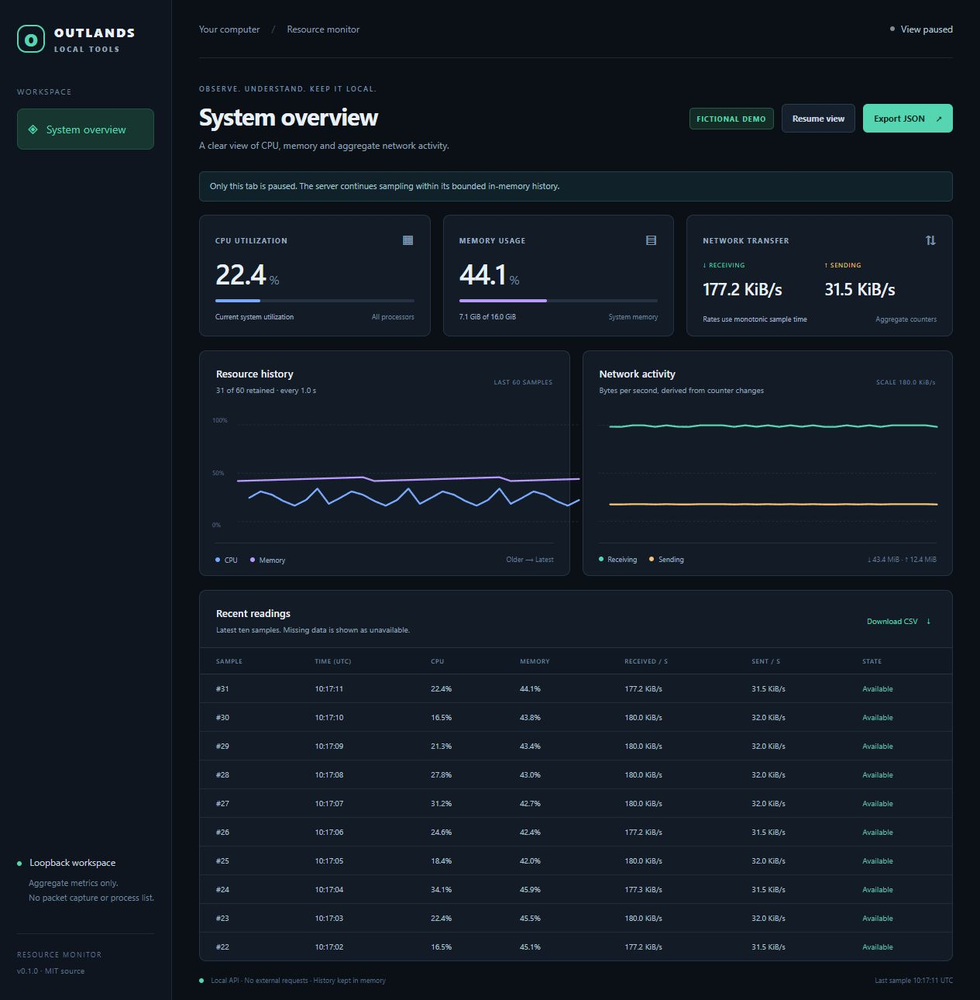
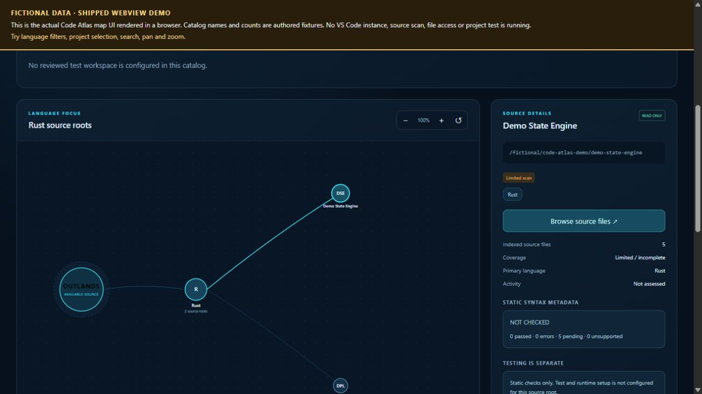

# OUTLANDS interface showcase

These are real browser captures made on 2026-10-26 from the original interfaces with fictional data. They are screenshots, not generated design mockups. Neither image contains a live personal project catalog, machine metrics, private infrastructure, credentials or real user data.

## Resource Monitor

- Source: [outlands-public-tools at 0d49874](https://github.com/TheOutlandsDev/outlands-public-tools/tree/0d49874173efa3046cd8a8ff689a2d767cb61920/tools/resource-monitor).
- The unchanged Python server and web interface ran locally using `python -B -m resource_monitor serve --demo --port 0 --interval 1 --history 60 --duration 1200` with Python 3.12.14. The view was paused before capture.
- Its **FICTIONAL DEMO** mode supplies synthetic samples. No live machine metrics were read, and the optional live sampler was not used. No dependency installation was needed for this demo.
- This capture demonstrates the demo dashboard's rendering. It does not establish live metrics accuracy or downstream system health. Follow the module's README for your own demo or live setup.

## Code Atlas

- Source: [code-atlas at cbf53bd](https://github.com/TheOutlandsDev/code-atlas/tree/cbf53bd53b486af392fafa1b062309581eac4d86/extension/media).
- `app.js` and `styles.css` came byte-for-byte from the committed source. The HTML used the normal template substitutions plus a local fixture bridge in place of the VS Code host.
- Six authored **Demo** projects under a fictional path supplied the sample catalog. The screenshot shows the actual language filter, graph and project-detail interface after selecting Rust and Demo State Engine.
- The outside-app disclaimer remains visible. Catalog counts are authored fixtures, syntax status is **NOT CHECKED**, and tests are unconfigured.
- No VS Code instance, filesystem scan, source-file access or project test ran for this capture. The fixture bridge intercepted host requests; it supplied no real VS Code or filesystem operations. This is UI demonstration, not VS Code integration acceptance.
- To try the complete extension, follow [the tested revision 2 setup guide](https://github.com/TheOutlandsDev/code-atlas/blob/main/docs/setup-r2.md).

The original repositories retain their own licenses, upstream notices and validation scope.
